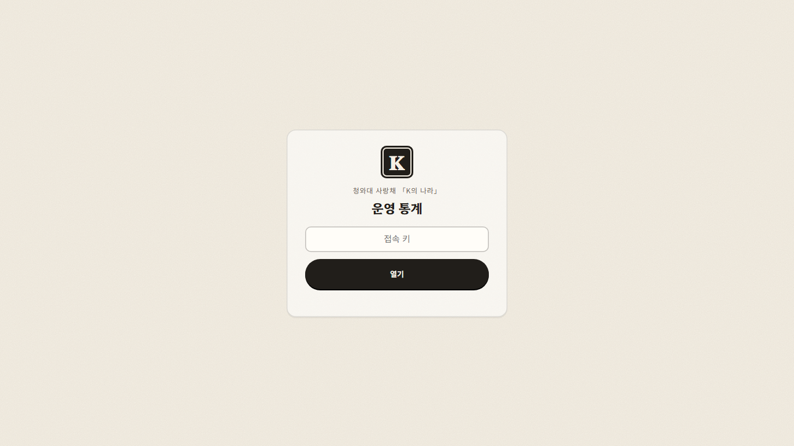
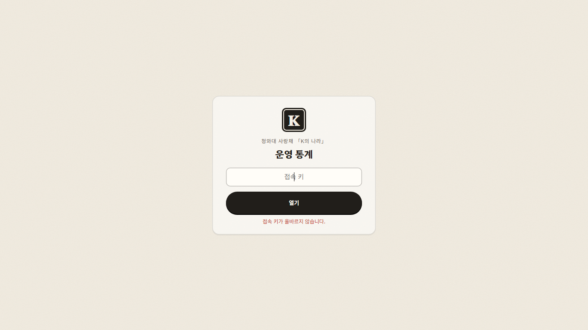
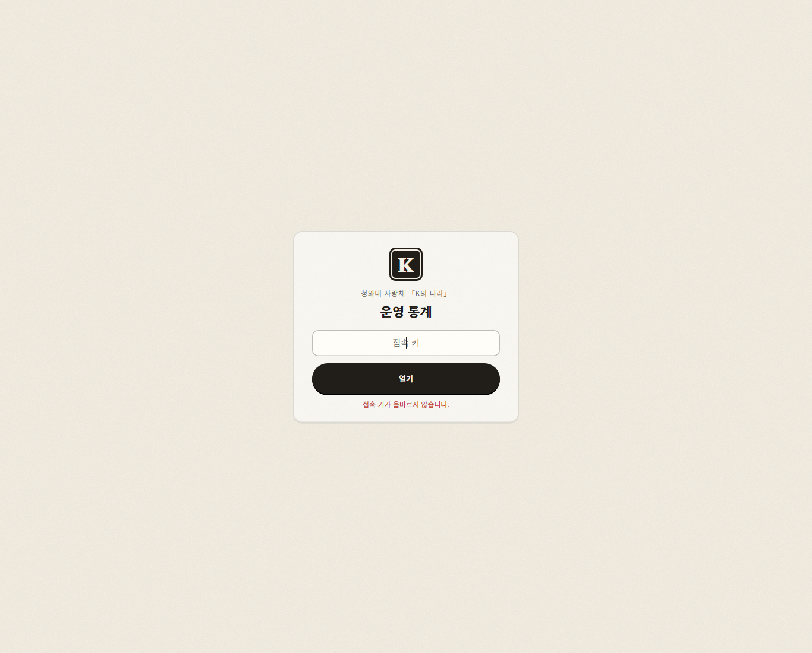
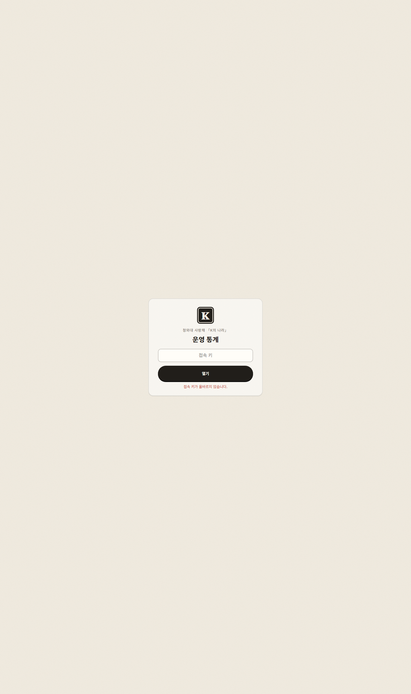
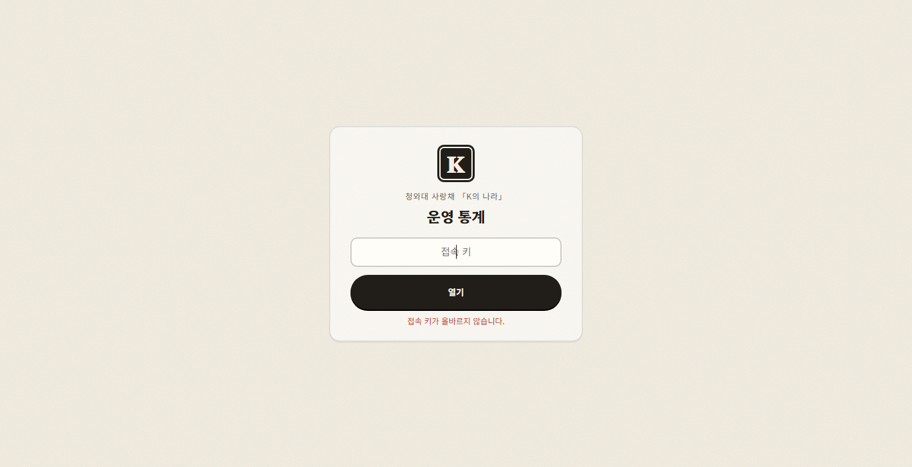
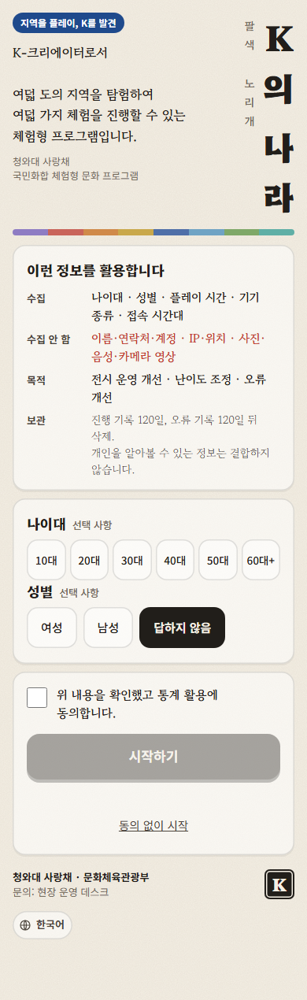
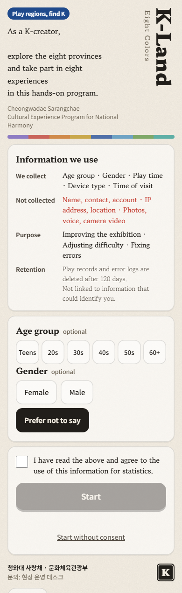
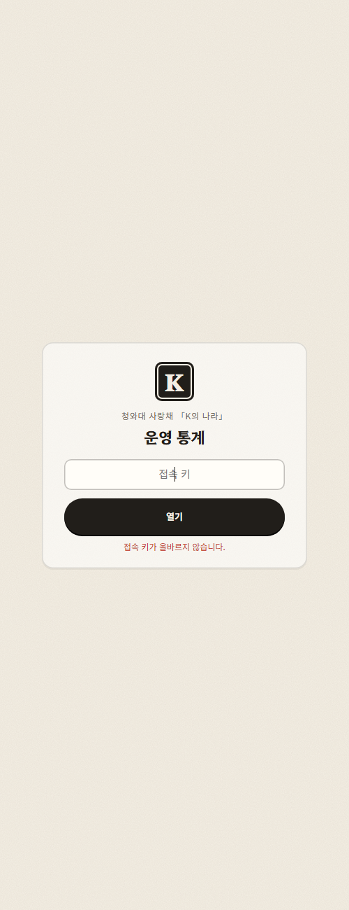

# 운영 가이드 — 판타스트릭 내부용

「K의 나라」 운영 통계 화면을 매일 여는 담당자를 위한 안내입니다. 개발 지식은 필요 없습니다.
화면에는 숫자와 제목만 있고, **뜻풀이는 이 문서에** 있습니다. 화면은 게임과 같은 톤(한지 배경·먹 도장·오방색 포인트, `docs/디자인가이드.md`)으로 맞춰져 있습니다. (아래 캡처는 검증용 가짜 데이터입니다.)

## 1. 열기
1. 주소 **https://knara.tndn1102.workers.dev** 를 PC 또는 폰 브라우저에서 엽니다(손님용 입장 페이지는 https://knara.tndn1102.workers.dev/entry/ )(엣지·크롬·사파리, 1366×768 PC 기준).
2. 접속 키를 입력하고 **열기**. 키는 이 탭에만 기억됩니다. 키가 든 링크(`…/?key=…`)를 받았다면 그냥 열면 되고, 주소창의 키는 바로 지워집니다.
3. 자리를 비울 때 오른쪽 위 **잠금**.

## 2. 첫 화면(개요) — 항목마다 맞는 차트

실제 통계 제품(Plausible·Umami·GA·Cloudflare·네이버 애널리틱스 등 11곳)의 관행을 따라, 지표 종류별로 다른 형식을 씁니다(`docs/벤치마크_통계대시보드.md`). 색은 **청(방문·1순위)·놋쇠(완주·2순위)·회색(기타/응답 안 함)** 세 가지뿐이라 색을 외울 필요가 없습니다.

| 카드 | 형식 | 읽는 법 |
|---|---|---|
| **총 방문자** | 큰 숫자 + ▲▼ 전기 대비 + 작은 추세선 | "▲ 10% 지난 7일 274명 대비" = 바로 앞 같은 길이 기간보다 10% 늘었다. 추세선은 기간 안 일별 방문. 앞 기간 자료가 없으면 "비교 기간 자료 없음" |
| **완주율** (놋쇠 띠) | 큰 숫자 + 램프 미터 + ▲▼ %p | 미터 길이 = 완주율. "▲ 2%p" = 앞 기간보다 2%포인트 높다. 아래 완주자 수 |
| **오늘 방문자** | 큰 숫자 | 오늘(한국시간) 세션, 완주 수, 마지막 수집 시각 |
| **일별 방문·완주** | 선 + 면(방문 청) / 선(완주 놋쇠) | 오른쪽 끝에 마지막 날 값만 표기. 선 위에 마우스를 올리면 날짜별 방문·완주·완주율 |
| **나이대** | 세로 막대 | 응답한 사람 기준 %. 건너뛴 사람은 제외(머리 오른쪽 "응답자 N명 기준") |
| **성별 · 접속 기기** | 도넛 + 가운데 수치 + 범례 | 가운데 = 가장 큰 조각. 범례에 %와 건수. 조각에 마우스를 올리면 수치 |
| **언어 · 브라우저** | 가로 막대 순위 | 많은 순. 브라우저는 상위 4 + 기타. 카카오톡·네이버앱처럼 앱 안 브라우저엔 "인앱" 배지 |

전체 화면: 

## 3. 기간 고르기
- **오늘 · 7일 · 30일 · 전시기간**(11월 2일부터) 알약. 날짜를 직접 고르려면 **기간 직접 지정 ▾** 를 눌러 시작일·종료일을 넣고 **적용**.
- **스태프 점검 플레이 포함** 체크는 자세히 탭 오른쪽 위에 있습니다(기본 제외).
- 모든 날짜는 한국 표준시, 세션 **시작 시각** 기준. 화면은 자동 갱신되지 않으니 **새로고침**.

## 4. 탭
### 놀이별

- 63종을 **도** 로 거릅니다(도 선택 예: ). 열 제목을 누르면 정렬.
- 열은 다섯: 도 · 놀이 · 유형(공용/아이돌/셰프/크리에이터) · **성공률** · 시도(작게). 성공률 막대 색: 45% 미만 붉음(어려움), 92% 이상 파랑(쉬움), 그 사이 초록. 성공률 = 성공 / (성공+실패).
- 성공·실패 건수, 소요 시간, 교체, 완주 기여 등 자세한 수치는 **내보내기의 "놀이별 집계" CSV** 와 보고서 3쪽에 있습니다.

### 내보내기 / 인쇄

- **CSV 받기** → 엑셀에서 바로 열림(기간은 위 필터). 보고서 첨부는 "방문자 구성 · 일별 방문 · 놀이별 집계" 3개면 충분. 원자료(이벤트·세션·오류)는 재분석용.
- **인쇄 / PDF 저장**: A4 3장 — 1쪽 방문자·완주율·오늘 + 나이대·성별·언어·기기(%) + 일별 / 2쪽 기기 상세·동의·노리개·환경 지표·시간대 / 3쪽 놀이별 표·오류 요약. 인쇄 창에서 "PDF로 저장", 막대가 안 보이면 **배경 그래픽** 켜기. 샘플: [12-report-A4.pdf](screenshots/12-report-A4.pdf)
- 주간 루틴: 월요일 "7일" → PDF + 방문자 구성 CSV.

### 자세히 (탭 오른쪽 끝) — 개요에서 뺀 것 전부

- 위 카드: **동의율**(미터, 입장 페이지에서 통계 활용에 동의한 비율), 완주 소요 중앙값, 인앱 브라우저, **센서 권한 거부·화질 자동 하향**(붉은 미터 = 낮을수록 좋음), 오류 세션.
- **시간대별 방문** 세로 막대(가장 많은 시간대만 진하게·숫자 표기) · **노리개(직업)** 도넛 · **성별·나이대 건수** · **완료한 도 개수** 세로 막대(8개 칸 = 완주, 놋쇠).
- **센서 권한**: 허용(초록)·거부(붉음)·미지원(회색) 100% 누적 막대 + 오른쪽 거부율.
- **운영체제/브라우저/기기 모델/화면 크기**: 손님이 "화면이 잘려요" 하면 그 기기·화면 크기가 얼마나 흔한지 봅니다. **iOS 인앱**(카카오톡 안에서 QR 을 연 경우)이 많으면 안내판에 "사파리/크롬으로 열기"를 적어 두면 줄어듭니다.
- **센서 권한**: 흔들기·기울이기(움직임)와 박수(마이크) 권한 허용/거부. 거부가 30% 를 넘으면 안내 문구·대체 조작을 점검. **화질 자동 하향 기기**: 저사양 대응이 동작한 모델.
- **관람 퍼널**: 입장 → 센서 권한 → 노리개 → 지도 → 방 진입 → 첫 놀이 → 도 1개 완료 → 8색 완주 → 결과 카드. "직전 %" 가 낮은 단계가 손님이 그만두는 곳.
- **완료한 도 개수**: 몇 개 도까지 하고 그만두는지. 3~4개에서 많이 끊기면 전체 길이(8도 × 3판)가 긴 것.
- **도(방)별**: 진입·완료·완료율·성공률·교체·소요(방 진입부터 색 획득까지 중앙값).
- **오류**: 같은 메시지 × 브라우저 × OS 로 묶음. 건수보다 **세션 수**가 중요. 표를 캡처해 개발사에 보내면 됩니다. "WebGL 손실" 은 3D 화면이 멈춘 사례, "화질 하향" 은 정상 동작.

## 5. 입장 페이지(손님이 보는 첫 화면)
 
일본어·중국어·스페인어: `screenshots/13-entry-ja-390.png` · `14-entry-zh-390.png` · `15-entry-es-390.png`
- QR → 이 페이지 → 언어·안내·나이대·성별·동의 → **시작하기** → 게임.
- "동의 없이 시작"을 누른 손님은 통계에 "미동의 1건"만 남고 게임 플레이는 기록되지 않습니다. 발주처가 미동의 입장을 막고 싶으면 운영사에 요청(`REQUIRE_CONSENT`).
- 바닥의 발주처 표기·문의처 문구, 외국어 4종 번역은 발주처 확정·검수 뒤 교체합니다.

## 6. 자주 묻는 것
| 질문 | 답 |
|---|---|
| 숫자가 0 | 기간 확인(전시기간은 11월 2일 이후). 연동 전이면 아무것도 안 쌓임. `…/api/health` 가 `"ok":true` 인지 |
| 방금 플레이했는데 안 보여요 | 폰이 1~2초 뒤 또는 화면을 숨길 때 보냅니다. 와이파이가 끊겼으면 복귀 뒤. 30초 뒤 새로고침 |
| 완주율이 낮은데 정상? | 전시장 체험은 중간 이탈이 많습니다. 자세히 탭 "완료한 도 개수"로 어디서 끊기는지 보고 도 수·판 수 조정 근거로 |
| 같은 사람이 두 번 하면 | QR 을 다시 찍으면 새 세션. 탭을 닫지 않고 다시 하면 같은 세션 |
| 나이대 "응답 안 함"이 많아요 | 선택 사항이라 자연스럽습니다. 동의율과 같이 보세요 |
| 접속 키 분실/유출 | 운영사에 연락 → `STATS_KEY` 교체 즉시 옛 키 무효 |
| 폰에서도 보나요 | 네. 좁은 화면은 카드가 2열로 접힙니다 () |
| 숫자가 더 필요해요 | 개요는 일부러 짧게 두었습니다. 건수·시간대·노리개·브라우저·퍼널·도별·오류는 **자세히** 탭, 전부는 CSV |
| 개인정보는요 | 이름·연락처·IP 미수집, 나이대·성별은 구간값. `docs/개인정보처리설명.md` |

## 7. 운영사 월간 점검
- 기록은 120일 보관 뒤 `npm run wipe -- --yes` 로 전부 수동 삭제(README "기록 삭제"). 자동 정리는 없다.
- 앱 배포 시 `window.KSTAT.app_ver` 갱신. 동의 문구 변경 시 입장 페이지 `CONSENT_VERSION` 갱신.

## 검증 기록 (2026-10-11, 2차 · 2026-10-13 D1 단일화 뒤 112/112 재확인)
- 저장소: 운영 = Cloudflare D1. 로컬 검증은 같은 SQLite 방언의 `node:sqlite` 로.
- 시드: 10일치 일반 421 + 스태프 12 + 중복 전송 시험 1 세션(동의 387 · 미동의 34, 나이대·성별 건너뜀 15%, 놀이 7천여 판, 오류, 기기 11종). 실제 HTTP `/api/track` 전송 26초.
- 대조 `scripts/verify.js` **109항목 중 109 일치** — 방문·오늘 방문·완주·동의/미동의·나이대 7·성별 4·언어 5·브라우저 6·OS 3·인앱·노리개·퍼널 9단계·놀이 63종 카운트·소요 중앙값·완주 기여 정합·도별·분포·일별·시간대·센서·대체조작·화질하향·WebGL·오류·스태프 포함/제외·401·CSV 행수. 중복 전송 세션은 1회로 집계.
- 입장 페이지 실브라우저 시험: 크롬 headless 로 `/entry/?__auto=agree` · `?__auto=skip` 실행 → 세션 CSV 에 `entry-1.0` 세션 2건(동의 1: 20대·여성·ko / 미동의 1: 나이대·성별 없음) 반영 확인.
- 화면: 1366×768 첫 화면 + 전체 길이 + 500 폭(headless 최소 창 폭) + 입장 페이지 ko/en, PNG 12장 + A4 PDF 3쪽(`docs/screenshots/`). `npm run check` 통과.
